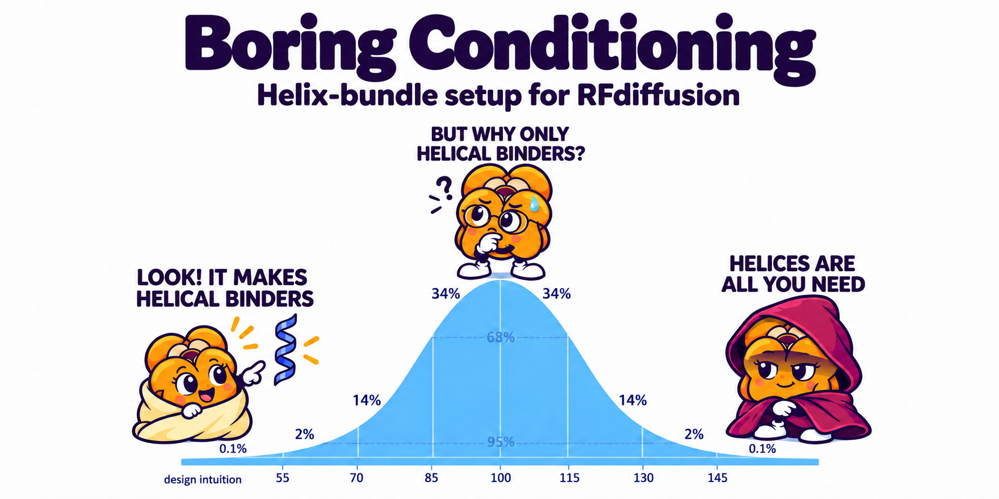

> Banner adapted from a meme posted by **Martin Pacesa** on LinkedIn.
> <!-- TODO: add the post URL -->

**A ready-made scaffold set that makes RFdiffusion produce helical-bundle
binders instead of whatever topology it feels like.**

Clone it, point RFdiffusion at `scaffolds/`, and every design comes out a
3-, 4-, 5- or 6-helix bundle. "Boring" on purpose: predictable, well-behaved
folds you can actually filter and build on.

---

## What you actually need

Fold conditioning reads exactly **two tensors per scaffold** and nothing else.
Confirmed in RFdiffusion's source: it globs `scaffold_dir/*_ss.pt`, strips the
suffix, and loads the matching `_adj.pt`. No PDB is ever opened from that
directory.

| What | Where it comes from |
|---|---|
| `<name>_ss.pt`, `<name>_adj.pt` for each scaffold | **this repo** — `scaffolds/`, 374 pairs |
| your target structure | you |
| `<target>_ss.pt`, `<target>_adj.pt` | you, one command (below) |
| hotspot residues on the target | you |

Plus [RFdiffusion **v1**](https://github.com/RosettaCommons/RFdiffusion) and
its `SE3nv` environment. That is the whole list.

## Use it

```bash
git clone <this repo> boringConditioning
```

Make the two tensors for **your target** — one-off, same helper that made the
scaffolds:

```bash
python $RFDIFFUSION/helper_scripts/make_secstruc_adj.py \
    --input_pdb my_target.pdb --out_dir target_folds/
```

Then design:

```bash
$RFDIFFUSION/scripts/run_inference.py \
    inference.output_prefix=out/binder \
    inference.num_designs=100 \
    scaffoldguided.scaffoldguided=True \
    scaffoldguided.scaffold_dir=boringConditioning/scaffolds \
    scaffoldguided.target_pdb=True \
    scaffoldguided.target_path=my_target.pdb \
    scaffoldguided.target_ss=target_folds/my_target_ss.pt \
    scaffoldguided.target_adj=target_folds/my_target_adj.pt \
    'ppi.hotspot_res=[A59,A83,A91]' \
    scaffoldguided.mask_loops=False \
    denoiser.noise_scale_ca=0.5 denoiser.noise_scale_frame=0.5
```

Each design picks a scaffold at random, so the output is a mix of lengths and
helix counts. Three things worth knowing:

- **`target_ss` / `target_adj` default to `null` and are optional** — it runs
  without them, but the Baker lab recommends supplying them for PPI, and they
  cost one command.
- **`mask_loops` defaults to `True`.** Set it `False` to get the scaffold's
  exact length; leave it `True` only if you want loop lengths to vary.
- With 374 scaffolds and fewer designs you will see *"Scaffold set is bigger
  than num_designs"*. That is expected, not an error — it samples randomly, so
  not every scaffold gets used. Add `scaffoldguided.systematic=True` to walk
  the list in order instead.

### Choosing a subset

Scaffold names carry everything: `4h_067res_c03` is a 4-helix bundle, 67
residues, cluster 3. Filter them into a list and pass it:

```bash
# only 4-helix bundles of 60-70 residues
ls scaffolds/*_ss.pt | sed 's|.*/||; s|_ss\.pt$||' \
  | awk -F'[_r]' '$1=="4h" && $2>=60 && $2<=70' > subset.txt

scaffoldguided.scaffold_list=subset.txt
```

---

## What you get

`scaffolds/` holds **374 scaffolds** as `<name>_ss.pt` + `<name>_adj.pt` pairs.
Each is one *distinct fold* — duplicates were removed by structural
clustering, so 374 files mean 374 different shapes, not 374 near-copies.

| Topology | Folds |
|---|---|
| 3-helix | 68 |
| **4-helix** | **179** |
| 5-helix | 103 |
| 6-helix | 14 |

Lengths span **54–102 residues**, with no gaps in the 4-helix set from 58 up:

```
54:1   57:1   58:5   59:4   60:5   61:6   62:6   63:4   64:6   65:5
66:6   67:14  68:3   69:9   70:6   71:4   72:2   73:2   74:5   75:1
76:3   77:1   78:3   79:4   80:2   81:3   82:5   83:2   84:2   85:3
86:2   87:2   88:1   89:3   90:3   91:2   92:5   93:2   94:1   95:3
96:6   97:7   98:12  99:3   100:4
```

### Why there are no PDB files here

Fold conditioning never reads a scaffold's coordinates. It reads two tensors:
a per-residue secondary-structure string and a matrix of which helices touch.
That is all `scaffolds/` contains — topology, no structures. The design models
they were derived from are unpublished and stay private, and you do not need
them to use this.

### Honest limits

- **RFdiffusion v1 only.** v2 documents motif scaffolding and never mentions
  fold conditioning; v3's input spec answers *"Can I guide on secondary
  structure?"* with *"Currently no"*.
- A scaffold fixes the **design length**. Nothing below 54 residues is
  reachable. To hit a length between scaffolds, let the model insert residues
  (`scaffoldguided.mask_loops=True scaffoldguided.sampled_insertion=15
  scaffoldguided.sampled_N=5 scaffoldguided.sampled_C=5`) — but that only ever
  *adds*, so the shortest scaffold is a hard floor.
- Scaffolds came from several design campaigns and vary in how well they were
  validated. Most passed AlphaFold multimer filtering; some are raw design
  backbones kept because they were the only fold at their length. They are
  conditioning templates, not validated binders.

---

## Build your own

Everything above was produced by the pipeline in `scripts/`. Run it on your own
design outputs to extend this set or build a different one.

```bash
conda create -n boring python=3.11 -c conda-forge mdtraj numpy matplotlib
conda activate boring
```

Also needed: [foldseek](https://github.com/steineggerlab/foldseek) for
clustering, and RFdiffusion for the final conversion.

| Step | Command |
|---|---|
| 1. Pull in designs that passed your filters | `scripts/harvest_complexes.py` |
| 2. Extract the binder chain | `scripts/get_chain.py` |
| 3. Inventory topology and geometry | `scripts/inventory.py` |
| 4. Cluster, keep one per fold | `scripts/cluster_scaffolds.py` |
| 5. Record provenance | `scripts/make_library_manifest.py` |
| 6. Convert to tensors | `cluster/1-make_secstruc_adj.sbatch` |

Each script has `--help` and a docstring explaining the non-obvious choices.
Two worth knowing before you start:

**Step 1 is fiddlier than it looks.** Design pipelines rename files after
scoring, so the score table's filename column usually matches nothing on disk.
`--name-template` rebuilds the disk name from the other columns; use
`--dry-run` first.

**Step 4 is where a library's real size appears.** Clustering runs per
(topology, length) — a scaffold is only interchangeable with another of the
same length — using foldseek TM-score rather than RMSD, because two
same-length bundles can place their helix boundaries differently. Our 2,177
usable structures collapsed to 374 folds, and one 180-design set turned out to
be a single fold.

### Filling a length nothing reaches

Because the tensors are just topology, you can write them directly: rescale a
real bundle's measured secondary structure and adjacency to a length that has
no structure, then condition on that.

```bash
# workstation (needs mdtraj)
python3 scripts/make_synthetic_ss_adj.py --measure \
    --sources library/4h_060res/*.pdb --json topologies.json
# cluster, inside SE3nv (needs torch)
python3 scripts/make_synthetic_ss_adj.py --json topologies.json \
    --lengths 58,59 --out-dir synthetic_scaffolds
sbatch cluster/2-design_missing_lengths.sbatch
```

That is how the 58–66 scaffolds here were made. Expect roughly a third of
designs to be usable at the shortest lengths, rising to about two thirds by 66
— at 58 residues there is barely room for four helices and many collapse into
a hairpin. Unconditional generation with a compactness potential does **not**
work: it controls radius of gyration, not helix count.

### Looking at what you built

```bash
python3 scripts/plot_library.py   --clusters inventory/clusters.tsv --output library.png
python3 scripts/plot_inventory.py --tsv inventory/inventory.tsv --output coverage.png
python3 scripts/plot_quality.py   --tsv inventory/inventory.tsv --output quality.png
```

`plot_source_survey.py` answers a different question — *is this source worth
harvesting?* — from a length sweep, before you copy anything.
`cluster/3-revise-unvalidated.sh` chains sequence design and a monomer
foldability test, to check whether an unvalidated backbone is designable.

---

## Layout

```
scaffolds/   374 ready-to-use conditioning tensors   <- the thing you want
scripts/     the pipeline that built them
cluster/     SLURM jobs (conversion, gap-filling, revision)
docs/        NOTES.md — what cost time when building one of these
batches.tsv  template for recording where each source batch came from
figures/     banner and coverage plots
```
